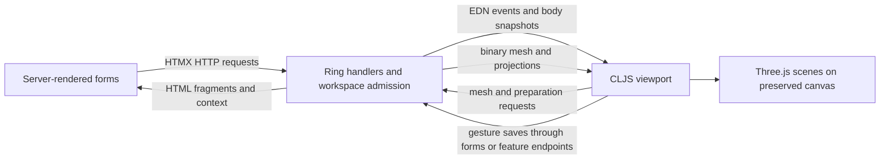

# Viewport developer guide

This guide describes the viewport integration API: how server-rendered controls,
background preparation and the Three.js browser island cooperate. It documents the
implementation on `main`; feature branches may extend this protocol.
[TECHNICAL.md](../TECHNICAL.md) remains the architecture reference, especially §6–8,
§13.3 (assembly), §14 (workspace ownership) and §15 (painting). Product behavior is in
[SPEC.md](../SPEC.md); supported user workflows are in the [manual](MANUAL.md).

## Ownership and entry points

The server owns selections, filters, workspace activation, display preferences,
assembly drafts and durable authored data. HTMX renders the controls and transports
ordinary navigation and mutations. The viewport owns GPU objects, cameras, orbit
controls, local gesture previews and asynchronous rendering work. It does not decide
assembly compatibility or persist a model by changing a Three.js object.



The browser build is `:viewport` in [shadow-cljs.edn](../shadow-cljs.edn). Its init
function is `shipyard.viewport/init` in
[viewport.cljs](../src/cljs/shipyard/viewport.cljs). `init` installs the loading/help/form
helpers, locates `#viewport`, calls `start!`, installs listeners and starts rendering.
`start!` creates one renderer and retained runtimes for `:browse`, `:ships` and
`:settings`. Each runtime has its own scene, camera, controls, selection, request
generations and scene resources. Assembly, schemes and Customize share the Ships
runtime while their server model cells remain distinct. Settings has an empty scene.

The canvas has `hx-preserve`: swap panels around it, never replace it to update a model.
Workspace switching deactivates the outgoing runtime and invalidates pending work;
it retains its scene and camera for later use. A page reload rebuilds browser runtimes
from server state; unsaved local camera/preview poses are not durable.

`init` is the exported entry point. Functions such as `put-part!`, `show-only!`, `clear!`
and `decode->geometry` are implementation helpers taking a runtime map, not a global
JavaScript application API. Integrations use the event/DOM/HTTP contracts below rather
than reaching into the private `state` atom. If WebGL or the bundle is unavailable,
server-rendered browsing and forms must remain usable.

## Server-to-viewport transport

[http/htmx.clj](../src/clj/shipyard/http/htmx.clj) owns event encoding and fragment
responses. The outer envelope is JSON for HTMX; **each event's value is an EDN string**.
`htmx/trigger` turns `:load-mesh` into `shipyard:load-mesh` and serializes its payload
with `pr-str`. HTMX wraps a string value in `event.detail.value`; the viewport reads it
with `cljs.reader/read-string`.

```clojure
(require '[shipyard.http.htmx :as htmx])

;; Use After-Swap when loading depends on the inspector DOM just returned.
(htmx/fragment inspector
  {:headers
   {"HX-Trigger-After-Swap"
    (htmx/trigger
      {:load-mesh {:url "/mesh/<hash>.0.symesh"
                   :part-id "Fleet/Cruiser/Hull" :mesh-key "<hash>"
                   :frame true :orientation [0 1 0 0] :mounts []}})}})
```

`htmx/fragment` also accepts `{:events {:clear nil}}` for immediate `HX-Trigger`
notifications. Do not pass a JSON payload map directly to the listener: its reader
expects EDN at `detail.value`.

There are three body transports with different shapes:

| Attribute | Encoding and consumer |
|---|---|
| `data-viewport-events` | JSON event-name → EDN-string envelope. `fragment` moves trigger headers exceeding 2048 UTF-8 bytes into hidden body inputs. `sync-viewport-events!` removes each node before dispatching its events. |
| `data-assembly-event` | One EDN assembly envelope. `sync-assembly-from-dom!` reads it under `#detail`, removes the node and checks workspace/activation before applying it. Always use this body transport for assembly snapshots. |
| `data-scheme-palette` | EDN palette projection containing `:workspace`, `:activation` and `:layers`. Consumed once to recolor the current Ships scene. |

HTMX's `afterSwap` pass consumes body messages and synchronizes region panels, grid
cards, authoring controls and preview state. Repeated unrelated swaps must not replay
a command. Hiccup performs attribute escaping; read the decoded attribute from the DOM.
Use body transport for variable-size data instead of increasing HTTP header limits.

### Events received on `document.body`

Unless noted, payload fields below are EDN map keys. Per-runtime listeners only run
while that runtime is active. This active check is not a replacement for request and
source identity checks at asynchronous completion.

| Event | Payload / effect |
|---|---|
| `shipyard:workspace` | `:mode`, `:activation`, `:colors`. App-level listener selects the retained runtime, sets activation and display state, enables its controls and resizes it. |
| `shipyard:display` | `:colors` boolean. App-level listener updates mount highlights/materials in the active runtime. The preference comes from the server. |
| `shipyard:load-mesh` | `:url`, `:part-id`, `:mesh-key`, optional `:frame`, `:orientation`, `:mounts`. Clears the current view, fetches geometry/topology, installs the source and optionally frames its bounds. |
| `shipyard:clear` | No data required. Clears the active runtime's model, authoring overlays and outstanding model identity. |
| `shipyard:status` | Status map, conventionally `:state` and `:message`; replaces the runtime status atom. |
| `shipyard:authoring` | `:state :enter`, `:part-id`, `:mesh-key`. Enters mount authoring only for the loaded source, then reconciles with the active inspector tool. |
| `shipyard:inspector-tab` | Local DOM notification; no EDN payload. Reconciles Part/Mounts/Regions with the selected tab. |
| `shipyard:facet-preview` | `:part-id`, `:mesh-key`, `:facet-indices`, `:frame`, optional `:roll-ambiguous?`, `:roll-source`. Installs the selected-face overlay only for the current authoring source; cut/border preparation may follow. |
| `shipyard:facet-error` | Clears the authoring preview. Error presentation stays in the returned form/status fragment. |
| `shipyard:clear-preview` | Clears authoring preview and its form fragment. |
| `shipyard:interfaces` | `:part-id`, `:mesh-key`, `:mounts`, optional `:orientation`. Refreshes saved mount highlights after checking the current source. |
| `shipyard:part-orientation` | `:part-id`, `:orientation`, optional `:saved?`. Matches the current part ID, rotates it and overlays, and updates the saved baseline when requested. This handler does not independently check a mesh key. |
| `shipyard:assembly` | Assembly command envelope described below. Listener exists, but server scene responses use `data-assembly-event` to avoid header limits. |
| `shipyard:region-projection` | Local readiness notification; rereads the source-bound region DOM snapshot. It does not carry a face mask in a header. |

The region DOM helper also emits `shipyard:region-projection-pending` while restoring
or loading masks. Brush lifecycle listeners use these notifications to coordinate
readiness. These local notifications do not use the JSON/EDN HTMX envelope.

## Workspace admission and stale results

[workspace/db.clj](../src/clj/shipyard/workspace/db.clj) serializes workspace transitions
and guarded operations. Only the server advances the activation. The hidden
`#workspace-context` marker rendered by
[workspace/views.clj](../src/clj/shipyard/workspace/views.clj) supplies:

- `X-Shipyard-Workspace` and `X-Shipyard-Activation`: the requesting context.
- `X-Shipyard-Scene-Sequence`: the last assembly scene sequence applied by the browser.
- `X-Shipyard-Assembly-Scroll`: inspector offset when applicable.

The shared HTMX attributes echo this context and prevent responses from an older
activation from being applied, even if their originating element was detached. The
middleware rejects malformed, stale or mismatched supplied contexts with an empty 204
before effects. A context-free request is not inherently rejected; direct fetch paths
therefore have explicit feature/source/lifetime validation too.

A transition returns destination panels, context, navigation/display controls and a
`shipyard:workspace` event together. Do not activate a workspace locally and then ask
the server to catch up. Going away and returning creates a new activation: matching
only the workspace name does not admit an old response.

There are several independent ordering tokens; keep their meanings distinct:

| Token | Protects |
|---|---|
| Workspace activation | A response belongs to this entry into this workspace. |
| Browse generation | A mesh load still belongs to the current Browse model session. |
| Part ID + mesh key | Geometry-dependent work targets this exact source revision. |
| Assembly sequence | Scene envelopes apply strictly newer server responses, including polls at the same draft revision. |
| Assembly slot token | A fetched object still belongs to this instance/slot after replacements and resets. |
| Preview request/revision + connected form identity | A face pick/cut result still belongs to the current authoring form and selected faces. |
| Region revision token | A mask/delta extends the snapshot currently installed for that mesh. |

Abort work when practical, and always check identity again before installing the
result. Cancellation alone cannot prevent an already-resolving callback from running.

## Assembly scene API

Server scene production is in [assembly/model.clj](../src/clj/shipyard/assembly/model.clj)
and [assembly/db.clj](../src/clj/shipyard/assembly/db.clj). The pure client state reducer
is [assembly/scene.cljc](../src/cljc/shipyard/assembly/scene.cljc).

```clojure
{:workspace :ships :activation 12 :revision 3 :sequence 5
 :commands
 [{:op :reset}
  {:op :set :slot [] :part-id "Fleet/Cruiser/Hull"
   :mesh-key "<hash>" :url "/mesh/<hash>.0.symesh"
   :matrix [1 0 0 0 0 1 0 0 0 0 1 0 0 0 0 1]}]}
```

`[]` is the root slot; descendants use paths of `[mount-id ordinal]` pairs. Repeated
part IDs in different slots are separate instances. Matrices are column-major vectors
of 16 numbers, acting on column vectors, with translation at indices 12–14. They
already compose placement and saved source orientation server-side; do not apply the
part quaternion again in the viewport. Part orientations elsewhere use `[x y z w]`
quaternions; triangle indices and mount frames refer to source geometry.

| Command | Effect |
|---|---|
| `:reset` | Clears slots and enters assembly mode with a new generation. Required to enter from Browse mode. |
| `:snapshot` with `:slots` | Retains only the listed slots. |
| `:set` with `:slot` and mesh/placement payload | Installs/replaces a slot. Unchanged geometry/placement can retain its request token across appearance updates. |
| `:remove` with `:slot` | Removes that slot. |
| `:paint` with `:slot`, `:changes` | Patches appearance on an existing slot, including detail deltas. |

Envelopes may also contain `:mount-markers` and deduplicated `:region-data` referenced
by commands' `:region-ref`. Slot appearance can include `:material`, `:layers`,
`:regions`, `:details`, `:emission` and prepared `:appearance-ref` resources. Follow the
producer/reducer contracts when adding fields; do not create a second placement path.

`accept-event` rejects absent/non-numeric or older/equal sequences. A new slot token
includes generation, sequence and command index. `current?` must still pass when
geometry or appearance resolves. Superseded scene objects are removed and disposed;
leaving the runtime invalidates pending slot fetches. The browser reports the applied
sequence in subsequent requests so the server can choose a coherent delta or snapshot.

## Viewport-to-server API

The viewport uses ordinary HTMX forms for saves wherever possible. It updates hidden
fields and calls [http/forms.cljs](../src/cljs/shipyard/http/forms.cljs) `post!`, which
processes the connected form and invokes `htmx.ajax` with that form as `source`.
This preserves workspace headers, validation, swap rules and error handling. Do not
use native `form.submit()` for background commands.

| Workflow | Transport and response |
|---|---|
| Mesh load | GET the provided content-addressed `/mesh/<key>.<tier>.symesh` URL. Decode using `shipyard.wire`; immutable mesh URLs can be cached. The interactive source also uses prepared paint topology. |
| Face pick / angle reselection | Direct URL-encoded POST `/facet`, with `part-id`, `mesh-key`, `triangle-index` and relevant current mount form fields. Returns HTML plus viewport events. No database save occurs just by selecting. |
| Mount cut/border preview | EDN POST `/mounts/preview` through `preparation/load!`; body includes source identity, owner/sequence, frame and indices plus applicable cut/border options. `/mounts/preview/cancel` releases obsolete owner work. |
| Saved interface outlines | Prepared `/mounts/previews?part-id=…&mesh-key=…` resource, rendered only if the source, activation and saved-interface projection still match. |
| Region stroke | `regions.transport/post!` submits the existing stroke form through the `region-cbor` HTMX extension. CBOR contains version, metadata, triangle count and either indices or an LSB-first bitset, whichever is smaller. |
| Region recovery | HTMX GET `/parts/regions/snapshot?part-id=…` replaces the source-bound region panel when its revision chain cannot be applied. |
| Customize stroke | Ordered URL-encoded POSTs to `/ships/paint/stroke` buffer intermediate parts; final commit uses the connected HTMX form. Intermediate responses must acknowledge `X-Shipyard-Brush: buffered`. |
| Grid orientation save | Writes current poses into the existing bulk save form, tracks the submitted baseline/sequence and uses its normal save lifecycle. |

Direct `/facet` fetches do not get HTMX's swap lifecycle automatically.
`post-facet!` captures activation, authoring identity, request number and target element;
it checks all of them before replacing `#facet-preview`, processing its forms and
consuming header/body events. Leaving Mounts invalidates pending picks, even when
returning to the same part. Preserve this admission logic for any new direct-fetch
fragment path.

### Preparation and region resources

[preparation.cljs](../src/cljs/shipyard/preparation.cljs) exposes:

```clojure
(preparation/load! url
  {:method "POST" :body request-data
   :current? still-current?
   :viewport? true
   :decode! decode-response!
   :ready! install-result!
   :failed! show-failure!}) ; => AbortController

(preparation/cancel! controller)
```

The default method is GET and decoder is `Response.arrayBuffer`. Request bodies are
EDN. The initial feature endpoint returns an EDN status envelope with `:state` and
`:resource`. `:running` polls `/preparation/<resource>` (or `:poll-url`);
`:overloaded` retries the feature endpoint; `:ready` fetches
`/preparation/<resource>/data` and decodes it. Other states fail. Callbacks only install
while `current?` is true and the controller has not been aborted. `:viewport-current?`
can further scope loading feedback without changing resource admission.

Use the feature's binary decoder for its resource. Topology comes from
`/paint/preparation/topology`; region and appearance projections have their own formats.
Do not treat these buffers as interchangeable with `.symesh`.
[paint/topology.cljs](../src/cljs/shipyard/paint/topology.cljs) provides a bounded cache
keyed by mesh identity and canonical face lookup; use it rather than reconstructing
stable face identity from displayed/transformed triangles.

The `#part-regions` panel supplies source identity, EDN `data-regions` metadata and
either a prepared `data-region-projection` URL, an empty marker or a revision-checked
`data-region-delta`. [regions/dom.cljs](../src/cljs/shipyard/regions/dom.cljs) owns the
preserved snapshot and recovery. Read it through `regions!`; do not infer saved masks
from current vertex colors. Projection readiness dispatches the local region event.

## Rendering, resources and feedback

The shared animation loop renders only the active runtime, with its camera and orbit
controls. Grid mode uses scissor rectangles on the same canvas for visible cards.
Ordinary rendering can include glow compositing, mount highlights and a separate
orientation-guide scene. A `ResizeObserver` updates the active camera/renderer;
Ship Browser accounts for the inspector's occupied area. Theme changes update the
scene background from `--viewport-bg` without changing model state.

Dispose replaced geometry, materials and overlays through the existing cleanup helpers.
Do not dispose shared topology buffers or the shared environment when removing a
single instance. A switch between retained runtimes differs from clearing/replacing a
model: the former preserves its scene, while still invalidating pending completions.

[viewport_loading.cljs](../src/cljs/shipyard/viewport_loading.cljs) owns presentation of
pending work through `begin!`, `track!`, `with-feedback!` and `capture-feedback`.
Requests provide a current-lifetime predicate and release their feedback on success,
failure or cancellation. Server `data-viewport-pending` markers cover polling gaps.
Brush feedback policy can suppress the overlay during continuous painting. The spinner
is a projection of pending work, not proof that face selection or mesh loading is
still running; inspect the relevant resource/token when diagnosing a stuck preview.

## Extending and debugging the integration

1. Decide the owner: durable model, workspace state or local rendering preview. Add
   domain decisions to the server/pure model before projecting them into the scene.
2. Reuse an existing event or body projection where its semantics fit. Add a payload
   field at both producer and consumer; use body transport for growing collections.
3. Carry source/revision/workspace identity through asynchronous work. Test leaving,
   returning, replacing a source and out-of-order completion.
4. Reuse the connected form for saves. Keep panels usable without the viewport bundle.
5. Verify GPU cleanup and camera retention as well as HTML. Document protocol changes
   here and update the architecture/spec when their contracts change.

For local commands and dependencies, follow [README.md](../README.md). Useful checks:

```bash
npx shadow-cljs compile viewport
clojure -M:test:natives-linux --focus shipyard.e2e.assembly-viewport-test
clojure -M:test:natives-linux --focus shipyard.e2e.workspace-test
npx shadow-cljs compile test
node target/js/node-tests.js
```

The dev build enables `shipyard.viewport/TEST-HOOKS`. It exposes
`window.__shipyard.stats()` and `lightingPixel(x, y)` for browser tests; the production
advanced build removes them. Stats describe the **active runtime**, including loaded
parts, assembly slots, preview/interface state, region readiness and workspace identity.
They are test diagnostics, not a production integration API. Browser test helpers live
in [test/clj/shipyard/e2e/support.clj](../test/clj/shipyard/e2e/support.clj); pure command
ordering tests live alongside the shared CLJC tests.

When an update disappears or a spinner persists, trace the response from its owner:
HTTP status and returned context → fragment/body message → admitted event → source and
sequence/token checks → preparation resource → installed scene. A stale 204, rejected
sequence, disconnected form or expired resource is a different failure from a shader
or WebGL error. Keep request logs source/revision oriented; avoid dumping dense face
payloads into logs.
